# Seifuku Decomp

Targeting patch 4351.

## Accounts and characters

- Login, the server list, and the refusals for a wrong password, an unknown account and an account already online
- Character creation for every class (Trojan, Warrior, Archer, Taoist), both sexes, and Chinese (GBK) names
- Character deletion, with and without a warehouse password
- First entry into the world, and the position, life, mana and money saved through a server restart
- Login and play through the real keyboard and mouse

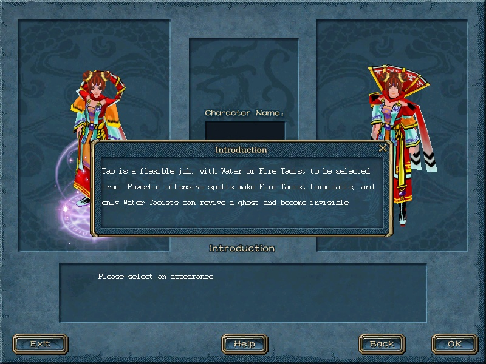

## Birth Village

- Every village NPC to the end of its dialog: Guide (including the skip), BirthManager, TaoistStar, Blacksmith, Warehouseman,
  Armorer, Pharmacist, Mr.Nosy, KnowItAll and OldGeneralYang
- Starter gear, OldGeneralYang's random skill lesson, and both village exits with their gifts

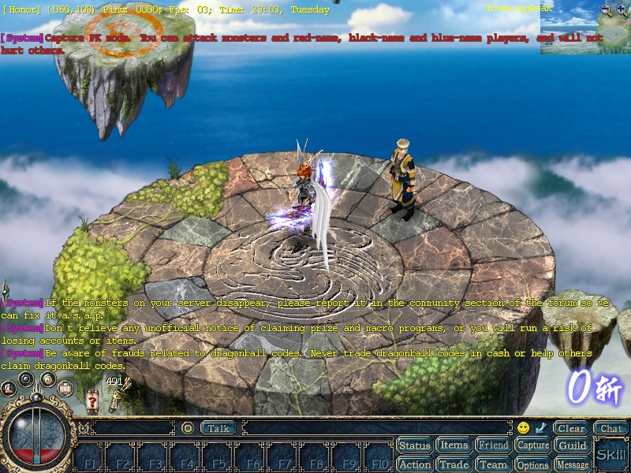

## Classes and promotions

- Every promotion through the real NPCs, for all four classes, up to the top rank: TrojanStar, WarriorGod, ArcherGod, TaoistMoon
  and Taoist, splitting into Fire and Water Taoist
- Attribute points spent from the Status panel, and reallotted at CelestialTao for a DragonBall
- Weapon proficiency rising with use, and skills levelling up with use
- The XP bar filling and the XP skills firing within their window

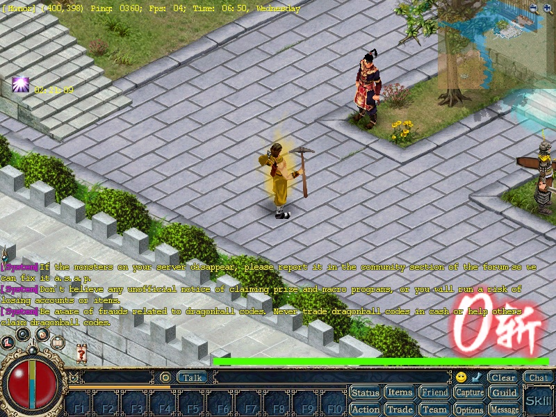

## Skills

- **Trojan:** FastBlade (hit and miss), ScentSword, Hercules, SpiritHealing, Cyclone, Accuracy, Roar, Robot, Superman
- **Warrior:** Superman, Shield, Dash, FlyingMoon, Accuracy, Roar, IronShirt
- **Archer:** Scatter, RapidFire, Intensify, Fly, ArrowRain, Poison on bow hits (with its ticks), arrows used up and combined
- **Fire Taoist:** Thunder, Fire, Tornado, FireRing, FireCircle, FireMeteor, Bomb, FireofHell, Volcano, Lightning, Meditation, Cure
- **Water Taoist:** HealingRain, StarofAccuracy, MagicShield, Stigma, Invisibility, AdvancedCure, Nectar, Pray, Revive, Bless
- **Summons:** SummonGuard (IronGuard) and SummonBat, joining the owner's attack
- **Transforms:** Turkey and the seasonal transforms, seen from a second player
- **All 14 weapon passives:** Phoenix, Seizer, Roamer, Earthquake, Boom, Rage, Celestial, Penetration, WideStrike, Boreas, Halt,
  SpeedGun, Snow, StrandedMonster
- Status effects and their timers: Stigma, MagicShield, Invisibility, Accuracy, Superman, Cyclone, IronShirt, Fly, poison
- Every class's attacks, casts and XP skills drawn the same on a watching player's screen

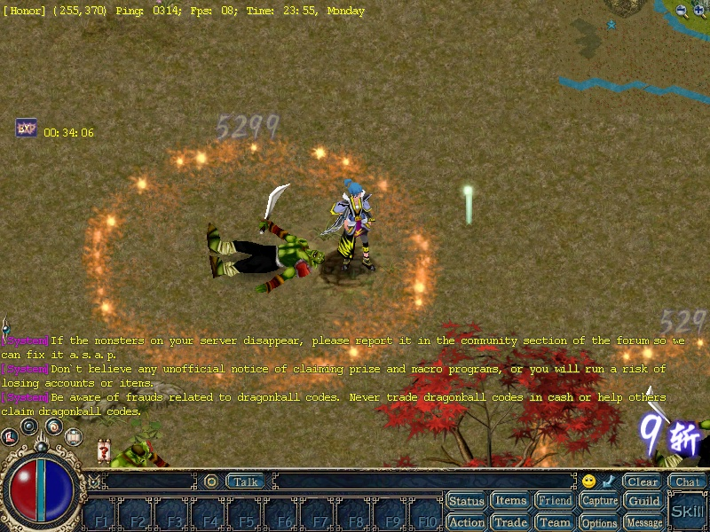

## Rebirth

- First rebirth at Eternity (normal and blessed mode, big and small body), from Water, Fire, Archer, Trojan and Warrior lives
- Second rebirth through the ExemptionToken and Alex
- Second rebirth through the Evil Abyss quest stages with Arthur, Bryan and Angela, and the SatanSeal opened
- Skills kept or reset by class, the reborn skills (Bless, CruelShade, IronShirt), gear downgraded, points granted, broadcasts
- Reflect from a Warrior life: about 20% against monsters and against players, and correctly absent when Warrior was not the
  second-to-last life

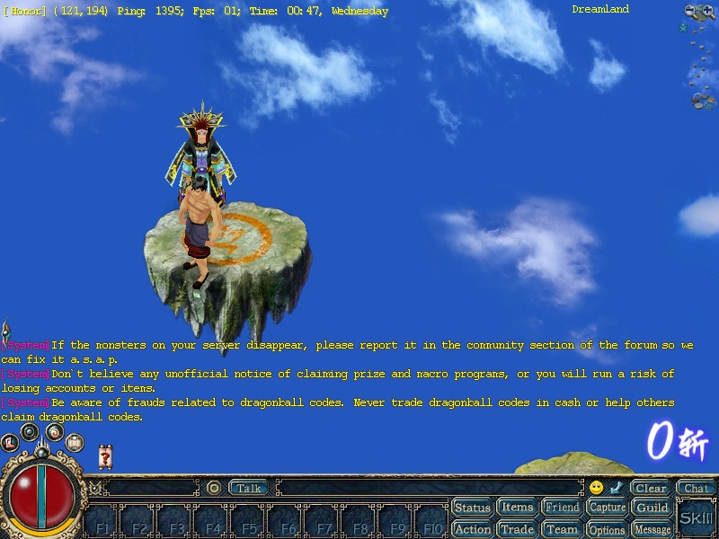

## Combat and PK

- Monster kills, experience, level-ups, monster drops of items and silver, and picking them up
- Monster magic (Thunder-casting MeteorDoves) and guards attacking PK players
- PK modes, PK points, red and black names, PK decay over time, the death drop of silver and bag items
- Jail: by a guard, by CaptainLi, or by the police list at 1000 PK; release by the Warden at low PK, for gold ores at 150, 500 and
  1000 PK, and by mining in jail
- The enemies list after a kill, PK bonus records, PenitenceAmulet
- Arena duels at ArenaGuard, reviving in the arena
- Death, ghost talk, reviving in town or in place

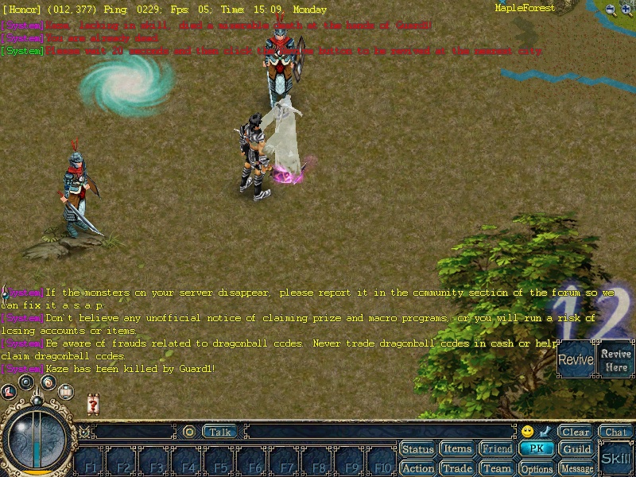

## Team, friends and chat

- Teams: create, invite, join by request, leave, kick, dismiss, team chat and shared experience
- Friends: add, whisper, friend chat, online notices, break off; leaving a message for an offline friend
- Chat channels: talk, whisper, team, guild, friend, ghost, booth cry-out, GM broadcast
- The message board: write, list, view, delete
- Viewing another player's equipment
- The ten emotes and the dances

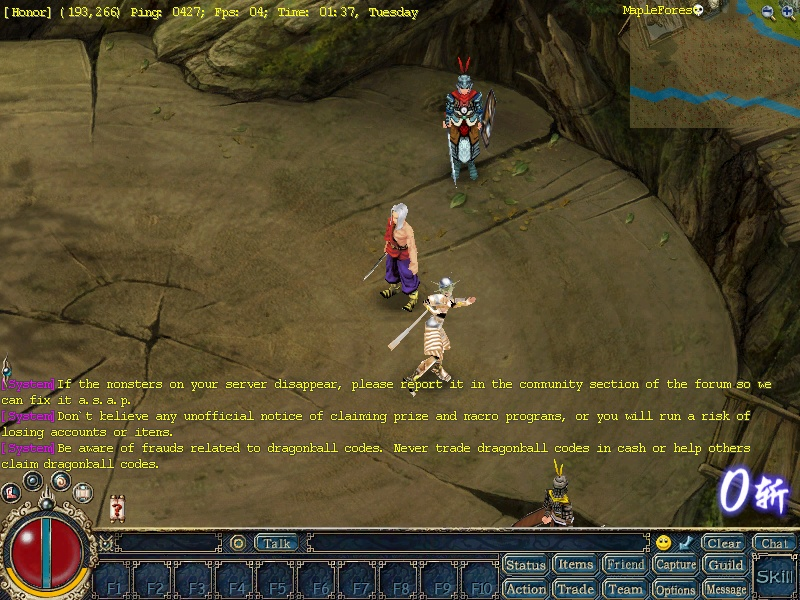

## Marriage

- Proposal at the Matchmaker by clicking the partner, acceptance, the wedding broadcast and fireworks, spouse in Status
- Divorce at Starlit
- Visiting the spouse's house

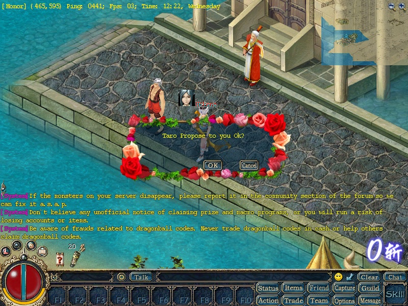

## Guilds

- Founding a guild, inviting, joining, quitting, expelling (online and offline), passing leadership, disbanding
- Deputy leaders appointed and removed, donations, the guild fund, announcements and the bulletin
- Allied and hostile guilds, with enemy guild names drawn in red
- Guild statues

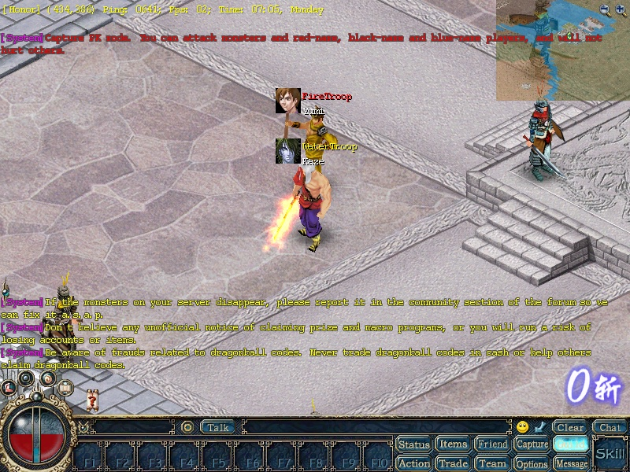

## Guild war

- Taking the pole by melee, magic and a summoned guard, the score list every 30 seconds, the winner's broadcast and ownership
- Gates opened and closed by the owner, and blown with Norbert's Bomb
- The war's start and end, the defending guild unable to hit its own pole, no PK penalty on the guild map
- The midnight teleporter charge, guild teleporters into the guild map
- The Guild Beast: paid for at the BeastGuard, spawned at 21:00, killed for a DragonBall

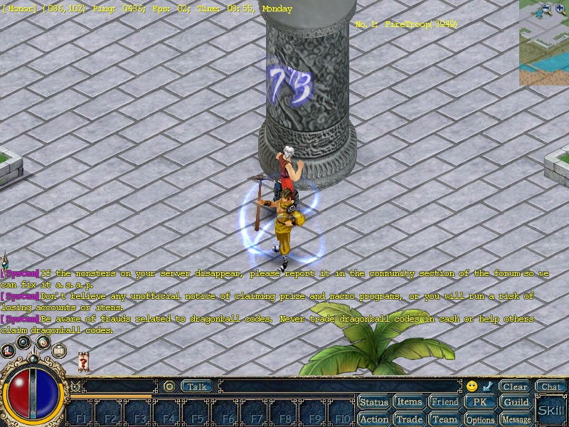

## Items and equipment

- Every equipment slot including both hands, shields, two-handed weapons and the overcoat slot
- Item tips for weapons, armour, gems, potions and quest items, including plus, bless, gems and enchant
- Durability loss and repair
- Sockets (ArtisanOu), gem embedding and removal (ArtisanCloud), quality upgrades (MagicArtisan, ArtisanWind), level upgrades with
  Meteors and DragonBalls (WeaponMaster, the improve window), enchanting at the WuxingOven, composing
- Dyeing armour, colour and black, at the Shopboy and the Tinter
- Potions, scrolls, city teleport gates, fireworks, PrayingStone blessing, double experience
- Drop and pick up of items and silver
- Mining with a PickAxe or Hoe on every mine type, and trading ores in to Stoneman, Craftsman and OldQuarrier

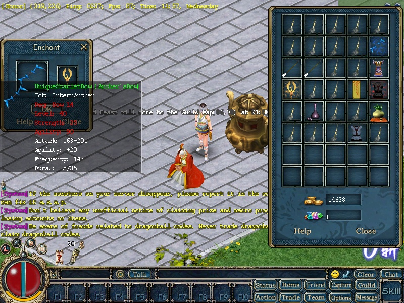

## Economy

- NPC shops in every city, buying and selling
- Warehouses (each keeps its own store), with silver and items, and the warehouse password at WhsGuardian
- Trading between players: items and silver, both sides changing offers, cancelling, and a disconnect mid-trade
- Booths: listing for silver and for CPs, buying from a booth, cry-out messages
- The CP shop (Shopping Mall)
- The lottery, the dice table with two players, the bonus prize claim

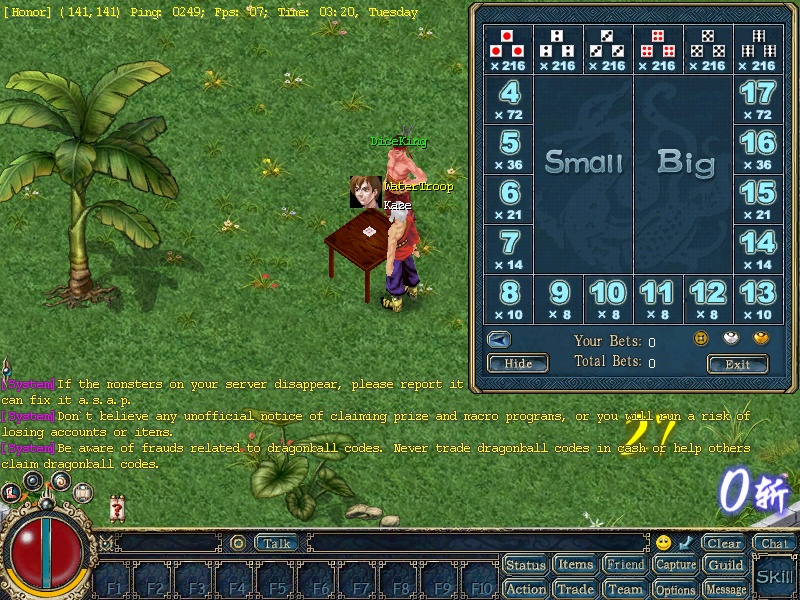

## Houses

- Buying a house, entering it, upgrading it to second class
- Furniture and the ItemBox warehouse

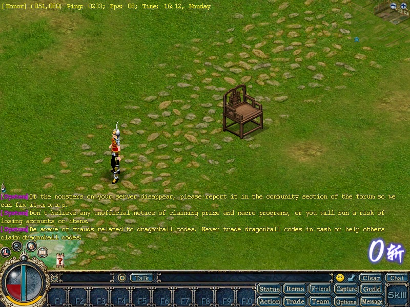

## Looks

- Changing face, hairstyle and body size

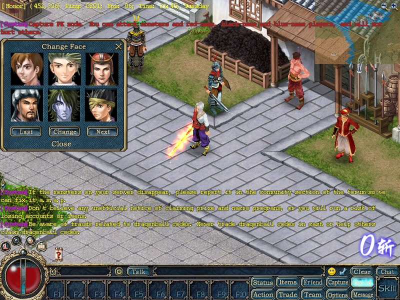

## Maps and travel

- Every map file drawn, including the maps with no NPC
- Walking, jumping, portals, the Conductresses, and fast map changes with crowds appearing at once
- Logout positions per map

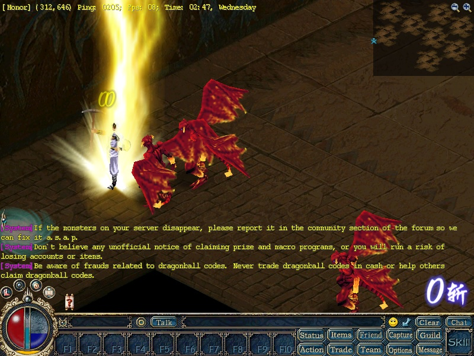

## Timed events

- Druggist, Tientsin, Emily and SolarSaint arriving on their timers
- The PK tournament: entry by ticket, level brackets, the weekly winner's prize
- Squama on the ground after 20:00
- Rare special MeteorDove and WaterDevil spawns with their drops

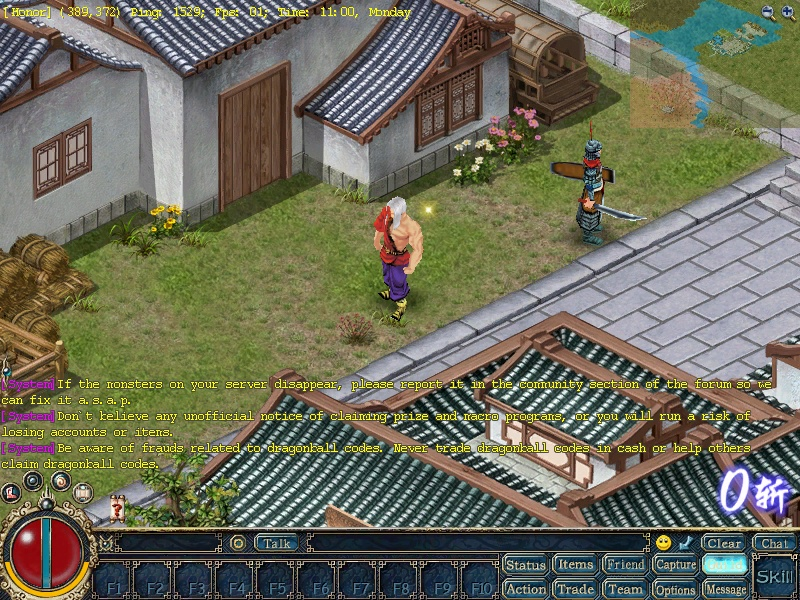

## Quest lines

- **Newbie quests** in Birth Village
- **The blue mouse:** General Judd, OldMiner, Silver Needle, the mouse caught in the mines
- **EscortChief's PeaceJade**
- **VillageHead:** GeneralShou's letter, and the StoneBandit's water source
- **Joy and Mike's Bow**
- **Carl's flowers**
- **AntiqueDealer and DoctorHolt**
- **Alcoholist's HealthWine**
- **Killer and Druggist**
- **GeneralQing's ArmyToken**
- **The Hades chain** to the WaterRing
- **Sky City Pass:** Daniel, every floor with its pens and tokens, the L120 stage, the GodCloud prize
- **Sky Pass Maze:** the kids, the prize-claiming map, KindTaoist's Meteors
- **The Moon Gem chain:** Mr.Pine, RichmanZhang, GossiperWang, Roger, William, the Alchemist, Emily, the Python, OldGeneral
- **Eight Diagram:** the tactics, the six tokens, SoulJade, MoonBox
- **SolarSaint's dresses:** HellGate, the cloister, BattleFormation, UltimatePluto, the PhoenixDress
- **Simon's diamonds** and the Labyrinth's four floor Generals
- **Sunfer's hit list:** offering, accepting, the bounty kill, adding to and cancelling an offer
- **TestIsland:** the class guards and amulets
- **The Globe quest:** Explorer, OldExplorer, Grandpa, Boatman, the islands and their mine
- **LoveStone, Shelby's virtue prizes, LadyLuck, the MacroJail, Norbert's Bomb**
- **Seasonal items:** Halloween, Thanksgiving, Christmas, Easter, Valentine's
- **PK tournament tickets** and the jail release
- **John and Richard's letter**
- **CoachLi's NameCard** to GeneralCai, and **Ref.Letter.Li** to CoachLin
- **Shirley's Windbell**
- **MountainKing's challenge** against the snakemen
- **Milly's love story** with Minner and Joe
- **Mr.Leisure's shield** from BlacksmithLi
- **GeneralChen's letters** with GeneralWu
- **OldmanTang's RatFang**
- **UnknownMan's wine** and his DragonBall experience
- **SurgeonMiracle's body change**

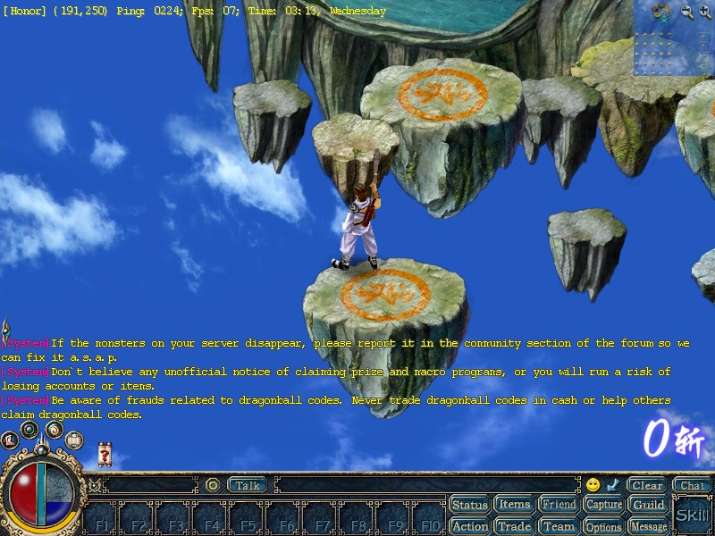

## Interface

- Options saved per character: names, counter, shadow, music, and both window sizes (800x600 and 1024x768)
- Hotkeys for skills and items, kept after relogging
- Status and Status Details, the chat settings and chat log, the minimap
- Screenshots (F12)

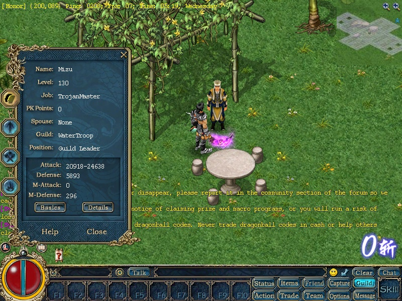

## Stability

- An hour idle and an hour of continuous fighting with two players: no freeze, no fault, steady memory
- Server restart with characters saved, kicks, and reconnecting during a team, a booth or a trade

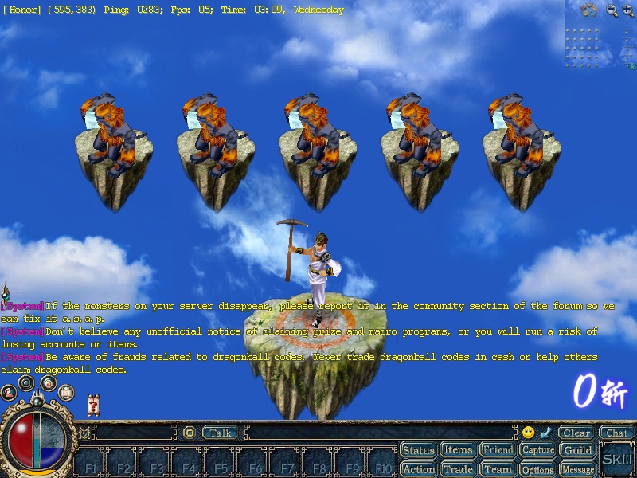
